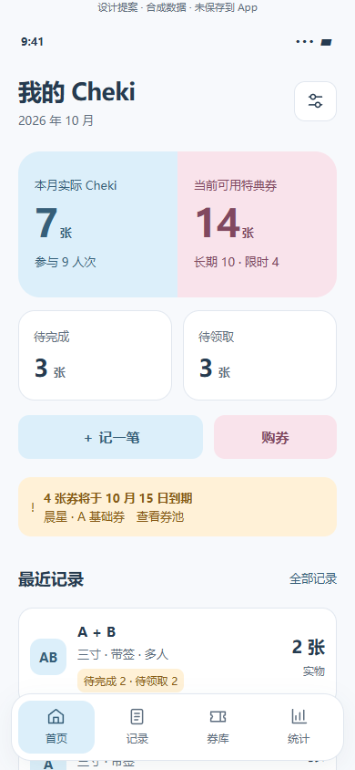

# Cheki 与特典券 UI 规范

本规范明确个人 App 的视觉与交互设计，供后续 Flutter 页面实现使用。用户已指定 **SalaryFlow 极简风、浅蓝与浅粉拼色**；页面布局是本轮提案，待实际预览后调整。产品范围、工作包、依赖和阶段状态仍以 MasterSheet 为准。

[可点击原型](ui/cheki-ui-prototype.html) 使用合成示例，展示首页、记录、券库、统计、管理和分步登记。它没有数据库写入能力，不代表 Flutter 功能已完成。查看方式：在浏览器中打开该文件。

## 1. 从 SalaryFlow 沿用什么

本轮只读参考 SalaryFlow 当前 `apps/web/src/styles.css`、`mobile.css`、`components/Shell.tsx` 和 `Shell.css`。参考的是源码布局规则，没有连接设备或声称核对最新手机渲染。

- 大数字优先，标签与辅助说明次之；卡片只保留与当前任务相关的信息。
- 页面留白、细边框、统一圆角，较轻的阴影；同一屏只突出一个主要动作。
- 四项底部导航，图标与文字并用；详情和管理不扩张主导航。
- 简短反馈与轻微按压动效；减少动态效果设置下关闭动画。

本项目换用近白底和蓝粉色块。无需照搬 SalaryFlow 的绿色、深色主卡或薪资指标。组件自行实现，不复制其业务代码、数据或私钥。

## 2. 色彩与拼色规则

| Token | 色值 | 用途 |
| --- | --- | --- |
| background | `#F7F9FC` | 页面底色 |
| surface | `#FFFFFF` | 列表、输入、导航及普通卡片 |
| ink | `#263B50` | 标题、正文、数字和主要图标 |
| muted | `#5F6F80` | 辅助说明，不能通过降低透明度淡化 |
| line | `#E1E7EF` | 装饰分隔线，不作唯一的输入边界 |
| inputBorder | `#7C8EA0` | 可操作输入框边界 |
| chekiBlue | `#DCEFFA` | Cheki 主区域、主按钮底色、当前导航底色 |
| chekiBlueInk | `#365F79` | 蓝色块文字和图标 |
| ticketPink | `#F9E3EB` | 券库主区域、购券入口、次级强调 |
| ticketPinkInk | `#81485F` | 粉色块文字和图标 |
| warning / warningSurface | `#885B16` / `#FFF1D7` | 临期、手选过期券等警示 |
| danger / dangerSurface | `#A73748` / `#FDE9EC` | 校验失败、库存不足、危险操作 |
| success / successSurface | `#28634D` / `#E4F2EB` | 操作成功反馈 |

首页主卡为一个共同外轮廓，左侧浅蓝显示 Cheki 实物量，右侧浅粉显示可用券量，中间直接拼接；比例约 1:1。其他页面按信息区使用相同的纯色色块，不铺全屏渐变，不给每张卡都做双色背景。

蓝粉表示功能区域，不表示性别、团体、完成/领取状态或风险等级。成员自定义颜色用小色条/圆点和姓名共同表达；不强制成员只能选蓝粉，也不改变历史成员颜色。图表保留成员颜色，必要时用描边/纹理及文字保证可辨。

普通文字与真实背景对比度目标 ≥4.5:1；大字 ≥3:1，操作边界/焦点等非文字关键元素 ≥3:1。浅蓝粉用作背景，不能直接作为白底上的小字或唯一图标颜色。状态总有文字，警示同时有符号、具体原因和处理入口。

## 3. 字体、空间与组件

- Flutter 使用系统中文无衬线字体，数字使用等宽数字特性；不依赖在线字体加载。HTML 原型使用本机系统字体回退。
- 页面标题 24、主指标 38–42、区块标题 18、正文 15、辅助文字 13 逻辑像素。正文常规字重，数字和标题 600；行高 1.4–1.6。
- 水平边距 20，窄屏 16；间距按 4/8/12/16/24/32 组织。主卡圆角 24，普通卡 18，输入/按钮 12，标签 8。
- 行式列表优先，金额/数量靠右；较长姓名可换行。标题摘要可省略，但详情必须能看到完整名称及历史身份。
- 按钮、图标入口与标签选择最小触区 44×44；底部导航每项带文字。键盘焦点为深蓝 2px 描边。
- 导航避让系统底部安全区；内容留出导航高度。表单底部提交避让软键盘，页面可滚动，不能让键盘覆盖校验信息。
- 默认浅色。本轮不把蓝粉硬套到系统深色模式；深色方案另行设计和验收。

## 4. 页面结构

| 页面 | 首屏内容 | 主要动作与后续入口 |
| --- | --- | --- |
| 首页 | 当月实际 Cheki / 当前可用券拼色卡；待完成、待领取；临期提示；最近记录 | 一个主要按钮「记一笔」；「购券」次级入口；点指标进入相应明细 |
| 记录 | 日期分组，实物量/参与量；成员、尺寸、独立属性；完成/领取数量 | 全部/待完成/待领取筛选；点行进入原操作详情与状态调整 |
| 券库 | 可用/长期/限时数量；券种分组与期限；过期数量单列 | 购券；券详情内交换、赠送、调整及流水，来源与成本进一步展开 |
| 统计 | 明确期间和数量口径；基本总数、成员参与分布 | MVP 先基本数量/库存；M3 再加入完整过滤、表图、占比和统计导出 |
| 管理 | 团体/成员、券种/尺寸、备份恢复、设置 | 右上角独立入口；批量导入导出及旧映射按 M4 范围启用 |

顶部统一为页面标题和管理入口，避免英文大标题、欢迎语、装饰头像与无业务意义的插画占据首屏。列表不用照片缩略图，符合只管理数量的范围。

## 5. 记一笔：分步登记

「记一笔」进入独立表单，四步为 **记录 → 状态 → 用券 → 核对**。手机上使用可滚动全高页面或底部面板，返回/下一步位置稳定；返回保留本次输入。离开有未提交输入时提示丢弃或继续。原型展示表单流程，真实数据保存与中断恢复由对应业务包实现。

1. **记录**：业务日期、团体/成员（支持多人）、尺寸、实物张数。签名、背签、宿题是独立属性；日期/数量/参与者始终可见。
2. **状态**：完成与领取独立选择。全部同状态时提供快捷录入；展开混合状态显示四个数量桶及合计，必须等于实物量。宿题不强制未完成，多人共享同一实物状态。
3. **用券**：先明确「仅记录」或「记录并扣券」。每券种显示实际总扣量，下方逐池输入；修改某池不会自动修改另一池。始终显示已分配、所需和差额，支持显式「恢复自动」。多券种不强制总券数等于切数。库存不足和不一致不能进入提交；过期池仅用户主动选择并确认警示。
4. **核对**：展示实物张数、参与者、尺寸/属性、四种状态、全部券种及池分配；仅记录时明确「本次不扣券」。按钮为「确认记录」或「确认记录并扣券」。处理中禁用重复操作，最终业务仍由事务与幂等保证。

默认状态、补录扣券方式及成本排序仍受 MasterSheet 既有 DEC-009/010/011 等裁决约束。演示预选和样例不构成业务规则批准。

## 6. 详情、改状态与纠错

记录详情展示业务日期和录入时间、成员当时名称、实物与参与口径、四状态桶、实际用券与原操作。多人记录在任意成员入口看到的是同一条记录。

调整状态先选来源桶、数量、目标桶，预览前后变化；不能把「待完成」与「待领取」简单相加为实物量。编辑/撤销在详情的次级菜单；涉及下游先显示影响链和差异，再确认，不能只弹一个没有范围的“是否确定”。

券详情长期库存合并展示；价格/成本批次收在「成本来源」中。交换、赠送、库存修正各自有明确入口和摘要，不混成一张通用扣券表单。

## 7. 空、错、加载与可访问性

- 空列表给出实际原因与一个相关入口，例如「还没有记录／记第一笔」；筛选后无结果给「清除筛选」，不显示虚构示例充当真数据。
- 失败在字段附近说明原因并保留输入；页面级失败给重试。加载不先展示 0，未知成本显示「未知」。
- 待完成、待领取和临期卡都可进入匹配明细；任务结束显示简短反馈与查看入口。
- 支持 320–430 宽度；Flutter 文本放大到 200% 时使用自适应换行/滚动，不能靠缩小字体。移动键盘、系统返回、TalkBack 读序和焦点须在 Android 实现后实际验证。
- 跨成员实物分组可能重叠，明确「分组不可相加」；参与数/实物数切换同步标签、总数、分母与明细。

## 8. 本轮原型如何检查

原型内姓名与数据完全合成：A 单切 3、B 单切 2、AB 多人 2，实物总计 7、参与总计 9。待完成 3、待领取 3，两者存在重叠。可用券 14（长期 10、限时 4），过期 1 单列保留。

可以切换四页、筛选记录、打开详情/管理、查看购券演示和登记四步。用券页先展示所需 5、限时 4、长期 1；将限时改为 2，长期仍为 1，提示差额 2 并阻止下一步；明确改长期为 3 后才能核对。演示扣券数和实物数无需相等。

提交按钮只结束演示并显示「演示完成，未保存数据」，不模拟真实业务成功或改变券库存。完整 BI 和数据管理入口明确说明所处计划阶段。

## 9. 后续开发与验收

后续 Flutter 以本规范的颜色 token、字体、圆角与触区构建公共组件，再在相应工作包实现页面。M1 验身份/记录/状态，M2 验券/联动/纠错闭环，M3 验完整 BI，M4 验迁移预览，M5 验实际设备可读性和交互。

本轮完成设计和浏览器原型检查不等于 Flutter 构建、Android 可访问性或用户布局验收。布局复核后只调整本规范与原型；业务与排期改变仍要同步四表，保留原始需求及历史日志。
