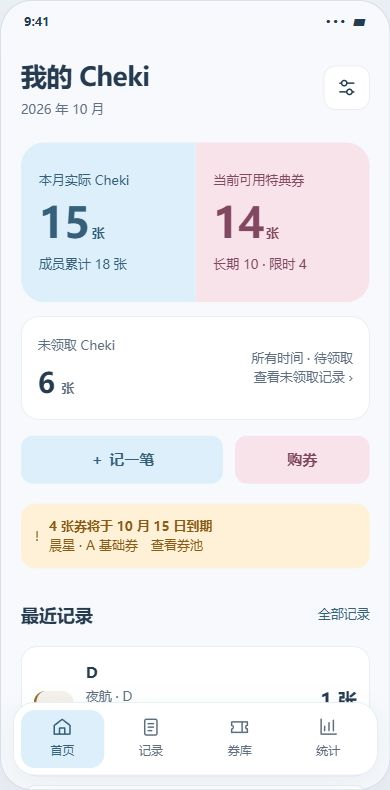

# Cheki 与特典券 UI 规范

2026-10-12 当前覆盖规则：所有业务信息可为空，按 [可空与补录要求](requirements/INCOMPLETE_ENTRIES_20261012.md) / DEC-045 实施。分类勾选允许清空，领取允许未知，日期/数量/成员/尺寸可不填；“新增”的快捷默认可清空，“补录旧信息”和编辑不套默认。历史原型中的禁止空分类/字段齐全才保存不再作为门槛。正常信息仍遵循互斥、条件背签和已知领取数量守恒；新字段未知不造事实，正式前另复核，不自动收紧。

本规范明确个人 App 的视觉与交互设计，供后续 Flutter 页面实现使用。用户已指定 **SalaryFlow 极简风、浅蓝与浅粉拼色**；页面布局是本轮提案，待实际预览后调整。产品范围、工作包、依赖和阶段状态仍以 MasterSheet 为准。

当前实施对照为 **UI-20261011-R1（WF-011）**，包含 WF-006 至 WF-010 的用户修订及四属性同行。它作为后续 Flutter 开发的 UI 基线；新增反馈继续修订并记录，不能将基线建立写成业务或阶段已完成。

WF-012 增加 M1 前置修复 **UI-FIX-001**：没有可用限时券时，首页不列限时零值与空临期；登记按所选券种隐藏零限时扣量栏，核对仅列实际非零分配。仅长期券时也省略「长期」标签，首页/券库/详情直接数量或「可用」，登记用「可用 N」，核对直接券名和张数；两种可用池同时存在才区分长期/限时。正库存恢复展示，历史期限与扣券事实保留。M1 检查组件 fixture，M2 接真实库存复验，见 [UI 修复规则](requirements/UI_FIXES_20261011.md)。

[仅长期券登记预览](ui/UI_LONG_ONLY.jpg) 保留用于核对 UI-FIX-001 的单池标签和全宽输入布局。

[可点击原型](ui/cheki-ui-prototype.html) 使用合成示例，展示首页、记录、券库、统计、管理和分步登记。它没有数据库写入能力，不代表 Flutter 功能已完成。查看方式：在浏览器中打开该文件。

[成员列表统计预览](ui/UI_STATISTICS.jpg) · [成员当天记录预览](ui/UI_MEMBER_DAILY.jpg) · [两页登记预览](ui/UI_RECORD_FORM.jpg) · [券归属预览](ui/UI_TICKETS.jpg)

[同行勾选及常开扣券明细预览](ui/UI_RECORD_ALLOCATION.jpg)（WF-011，登记页向下滚动；字段常开，核对按钮固定可达）。

## 1. 从 SalaryFlow 沿用什么

本轮只读参考 SalaryFlow 当前 `apps/web/src/styles.css`、`mobile.css`、`components/Shell.tsx` 和 `Shell.css`。参考的是源码布局规则，没有连接设备或声称核对最新手机渲染。

- 大数字优先，标签与辅助说明次之；卡片只保留与当前任务相关的信息。
- 页面留白、细边框、统一圆角，较轻的阴影；同一屏只突出一个主要动作。
- 四项底部导航，图标与文字并用；详情和管理不扩张主导航。
- 简短反馈与轻微按压动效；减少动态效果设置下关闭动画。

本项目换用近白底和蓝粉色块。无需照搬 SalaryFlow 的绿色、深色主卡或薪资指标。组件自行实现，不复制其业务代码、数据或私钥。

## 2. 色彩与拼色规则

| Token | 色值 | 用途 |
| --- | --- | --- |
| background | `#F7F9FC` | 页面底色 |
| surface | `#FFFFFF` | 列表、输入、导航及普通卡片 |
| ink | `#263B50` | 标题、正文、数字和主要图标 |
| muted | `#5F6F80` | 辅助说明，不能通过降低透明度淡化 |
| line | `#E1E7EF` | 装饰分隔线，不作唯一的输入边界 |
| inputBorder | `#7C8EA0` | 可操作输入框边界 |
| chekiBlue | `#DCEFFA` | Cheki 主区域、主按钮底色、当前导航底色 |
| chekiBlueInk | `#365F79` | 蓝色块文字和图标 |
| ticketPink | `#F9E3EB` | 券库主区域、购券入口、次级强调 |
| ticketPinkInk | `#81485F` | 粉色块文字和图标 |
| warning / warningSurface | `#885B16` / `#FFF1D7` | 临期、手选过期券等警示 |
| danger / dangerSurface | `#A73748` / `#FDE9EC` | 校验失败、库存不足、危险操作 |
| success / successSurface | `#28634D` / `#E4F2EB` | 操作成功反馈 |

首页主卡为一个共同外轮廓，左侧浅蓝显示 Cheki 实物量，右侧浅粉显示可用券量，中间直接拼接；比例约 1:1。其他页面按信息区使用相同的纯色色块，不铺全屏渐变，不给每张卡都做双色背景。

蓝粉表示功能区域，不表示性别、团体、领取状态或风险等级。成员颜色从成员身份设置读取；成员进度条、每日条图、月历有记录日期的色条和列表标记使用同一配置值，不能按排行位置或蓝粉主题硬编码。改色立即更新对应成员的全部展示；姓名/张数保持深色，低对比颜色加中性描边并保留文字。不强制成员只能选蓝粉，也不改变历史颜色的业务规则。

2026-10-14 用户要求补齐取色器：常见红/粉/橙/黄/绿/蓝/紫/黑/白预设、HEX 代码输入、R/G/B 各 0–255 的数值输入和 256 档滑块。任一合法输入同步颜色预览，非法值阻止确认；取消不改变原色，对话框确认回到表单、保存后写成员配置。现有画布保留。各页面共享保存的成员色，转团新身份沿用原色；新增成员明确选择，不依名字猜色。白色有描边，成员色不替代状态文字，portrait 大字与键盘仍可滚动操作。

普通文字与真实背景对比度目标 ≥4.5:1；大字 ≥3:1，操作边界/焦点等非文字关键元素 ≥3:1。浅蓝粉用作背景，不能直接作为白底上的小字或唯一图标颜色。状态总有文字，警示同时有符号、具体原因和处理入口。

## 3. 字体、空间与组件

- Flutter 使用系统中文无衬线字体，数字使用等宽数字特性；不依赖在线字体加载。HTML 原型使用本机系统字体回退。
- 页面标题 24、主指标 38–42、区块标题 18、正文 15、辅助文字 13 逻辑像素。正文常规字重，数字和标题 600；行高 1.4–1.6。
- 水平边距 20，窄屏 16；间距按 4/8/12/16/24/32 组织。主卡圆角 24，普通卡 18，输入/按钮 12，标签 8。
- 行式列表优先，金额/数量靠右；较长姓名可换行。标题摘要可省略，但详情必须能看到完整名称及历史身份。
- 380px 及以下窄屏将月历换为日期选择器，保留逐日列表，避免挤压七列日期触区。
- 按钮、图标入口与标签选择最小触区 44×44；底部导航每项带文字。键盘焦点为深蓝 2px 描边。
- 导航避让系统底部安全区；内容留出导航高度。表单底部提交避让软键盘，页面可滚动，不能让键盘覆盖校验信息。
- 默认浅色。本轮不把蓝粉硬套到系统深色模式；深色方案另行设计和验收。

## 4. 页面结构

| 页面 | 首屏内容 | 主要动作与后续入口 |
| --- | --- | --- |
| 首页 | 当月实际 Cheki / 当前可用券拼色卡；一个所有时间的「未领取 Cheki」入口；临期提示；最近记录 | 一个主要按钮「记一笔」；「购券」次级入口；点未领取进入匹配记录 |
| 记录 | 日期分组，张数/成员累计；团体成员、尺寸、属性；已领取/部分领取/未领取 | 全部/未领取筛选；点行查看原记录，可修改发生日期及全部字段 |
| 券库 | 可用/长期/限时数量；券种分组与期限；过期数量单列 | 购券；券详情内交换、赠送、调整及流水，来源与成本进一步展开 |
| 统计 | M3 实现日/周/月/年/所有、目标时间与可选团体筛选、去重实际张数；成员平铺列表，每行姓名带团体前缀/标签与成员色条形 | 点成员→月历与逐日张数→点日期查看当天记录；同阶段加入完整分析、成本与导出 |
| 管理 | 团体/成员、券种/尺寸、备份恢复、设置 | 右上角独立入口；批量导入导出及旧映射按 M4 范围启用 |

顶部统一为页面标题和管理入口，避免英文大标题、欢迎语、装饰头像与无业务意义的插画占据首屏。列表不用照片缩略图，符合只管理数量的范围。

### 统计入口：成员列表 → 日期 → 记录

统计首页以成员为一行，平铺展示「晨星 · A」「晨星 · B」「夜航 · C」「夜航 · D」。团体是姓名前缀或标签，用于标明归属和区分同名身份；不出现团体标题卡片、团体折叠层级或先选团体才能选人的步骤。团体筛选是可选过滤器，默认直接显示所有成员。每行显示该身份参与的张数、累计占比和设置色条形，点该行直接进入此成员的每日统计。

比例分母为当前时间和团体筛选后列表中各成员参与张数之和。总览按实物去重，成员多人参与分别计；稳定成员身份 ID 及团体前缀用于区分归属，不按名字合并。

统计有「日／周／月／年／所有」五个选项和目标日期选择器，上一/下一随粒度移动，范围直接显示。「所有」禁用日期与前后切换。规则采用上海业务日期、周一开周、自然月/年。所有 Cheki 指标只读取发生日期，领取或录入时间不改变归属；页面不反复显示口径说明。

点成员查看所选期间的每日张数；月范围提供月历，其他范围提供每日列表与范围内日期选择。点日期看当天数量、尺寸与原始记录；空日为 0。返回保留统计粒度、目标时间和可选团体筛选。

### 只保留领取状态

首页与记录快捷筛选为「未领取」，已领与未领数量之和等于总张数，不再出现完成维度。界面分开选择已领取、部分领取、未领取，新建默认已领取。按用户允许方案，初始已领取不设实际领取时间；后续补领记录数量和实际时间。历史已知时间保留，未知不补造，见 [最新登记修订](requirements/CHEKI_ENTRY_20261011.md)。

## 5. 登记：记录、核对两页

「记录」页填写发生日期，不填时间点；确认动作另留录入时间戳。参与成员用下拉逐个加入，选项带团体，已选标签可移除；Flutter 用可搜索多选面板，不平铺全部人选。无签/有签/宿题/背签四个勾选控件在正常字号下同一行排列；前三项恰选一项，快捷新建默认有签且无背签，背签仅有签可用。2026-10-14 用户明确保留四项 checkbox，撤回下拉提议。历史编辑沿原值与可空规则。切换非有签清除背签并禁用，切回不自动恢复。200%大字按可访问性自适应，不缩小字体强塞，见 [最新属性修订](requirements/CHEKI_ATTRIBUTES_20261011.md)。

领取分已领取/部分领取/未领取，默认已领取且初始不展示领取时间字段。部分领取及后续补领展开张数与实际领取时间，可添加批次。新建用券方式默认扣券，明细始终展开并移除折叠入口；仅记录隐藏扣量字段，切回扣券立即展示。保留每池独立分配和差额拦截。

「核对」页显示发生日期、成员、张数、尺寸/属性、领取与适用批次时间、用券明细。返回记录保留输入；正整数、参与者、日期、领取数量及券分配校验通过才可确认。正式提交仍由事务、幂等和库存/成本预检保证。

原型确认只更新当前合成内存记录，确认时留实际动作时间戳；用券明细用于核对，券库存不扣减，刷新恢复。该行为不代表真实保存或扣券成功。编辑载入原值，历史未知状态不从新建默认值推断。

## 6. 详情与全字段编辑

详情显示发生日期、录入时间戳、团体成员、张数、尺寸/属性、领取及适用的实际领取时间；不使用「实物」术语。提供「修改记录」入口，复用两页表单，可改日期、成员、张数、尺寸、属性及领取。核对页显示前后变化，取消不改变原值；ID、原录入时间保留，修改另留动作时间戳和修订历史。

修改发生日期刷新原/新日期统计；修改领取时间只改变领取信息。已领张数不得超过总张数，部分领取须严格小于总张数，领取日期不能早于发生日期。初始已领不追踪时间与历史时间未知须区分。有关联券和成本时先显示影响链与差异，再原子纠错。

券列表、详情及选择器均显示团体前缀，例如「晨星 · 通用券」，并标明个人/团体券；同名跨团不得混池。长期库存合并，成本来源另展开。交换、赠送、库存修正有独立入口和摘要。

## 7. 空、错、加载与可访问性

- 空列表给出实际原因与一个相关入口，例如「还没有记录／记第一笔」；筛选后无结果给「清除筛选」，不显示虚构示例充当真数据。
- 失败在字段附近说明原因并保留输入；页面级失败给重试。加载不先展示 0，未知成本显示「未知」。
- 未领取和临期卡可进入匹配明细；任务结束显示简短反馈，领取数量和实际时间可查。
- 支持 320–430 宽度；Flutter 文本放大到 200% 时使用自适应换行/滚动，不能靠缩小字体。移动键盘、系统返回、TalkBack 读序和焦点须在 Android 实现后实际验证。
- 团体实物与成员累计张数分别标注；成员占比使用当前筛选后列表的成员累计分母。日期下钻、团体筛选和明细保持一致，跨成员/跨团实物不可直接相加。

## 8. 本轮原型如何检查

数据均合成，详细时间对照见 [当前需求修订](requirements/CHEKI_CHANGE_20261011.md)。默认定位 2026-10-11：日 7、周 14、月 15、年 21、所有 24 张；默认全月成员 A8、B6、C2、D2。下一周只有 10/12 的 1 张；9/30 发生且 10/10 领取的 4 张仍在 9 月。所有时间未领取 6 张。

检查登记：日期到天，默认有签、已领取、扣券且无初始领取时间输入；成员下拉逐个加入/移除，不重复。无签/有签/宿题互斥且不能全不选；背签只有有签可用，切换清除禁用，切回不暗恢复。部分领取要填张数和实际时间；未领取不设时间。扣券明细常开无折叠。A默认1张，扣限时1/长期0；张数改5后建议限时4/长期1，手改限时2而长期仍1，差额2拦截，改长期3后通过。仅记录不扣券仍可核对。

检查编辑：点记录→修改记录，改变日期、成员、张数、尺寸或属性，核对差异后应用到演示；原ID和录入时间保留，修改动作另留时间戳。把10/11的AB2改日期为9/30，10月15变13，所有24不变；后续实际补领时间填为11月，10月仍13，所有仍24。刷新恢复样例。领取超额、部分领取等于总量、适用批次时间缺失会拒绝。

成员设置色继续联动条形/月历。券库「晨星 · 通用券」列表和详情均标团体。完整成本分析、真实持久化和库存纠错留给相依业务工作包。

## 9. 后续开发与验收

后续 Flutter 从 M1 开始采用 R1 基线，各工作包同时交付页面与业务。MasterSheet 的「执行约定」UI-01 至 UI-07 明确页面归属、依赖与验收；「版本规划」对应包的交付/验收列及 M1–M5 阶段产物已经同步。M0 先建立工程与数据安全，不靠空页面宣称产品完成。

M1 交公共主题/导航组件、团体成员颜色管理、首页记录区、记录列表详情、两页仅记录和编辑；此时未接入券功能。M2 接券库/购券/期限和首页券区、默认扣券及常开明细、换送纠错和完整恢复，完成核心 MVP 的界面闭环。当前原型中的五范围统计、成员每日下钻正式实现归 M3；因此四个主页面的真实功能到 M3 齐备，M2 不提前承诺完整 BI。阶段候选尚无能力的入口隐藏或禁用，不能用假成功反馈代替业务。

M4 的批量导入/旧映射与 M3 的完整成本 BI 等原型尚未细画的二级页，在对应包启动时补设计并复估。37–62 人日仍为整条路线粗估，主题和页面归已有范围，不额外建一个末尾换肤包；新增范围或复估变化须在四表保留历史。每个 UI 包交 Widget/页面数据对账和逐屏截图；有设备授权时补对应 Android 验证，M5 组合检查大字、读屏、键盘、系统返回及实际日用，不把所有 UI 检查延到最后。

本轮完成设计和浏览器原型检查不等于 Flutter 构建、Android 可访问性或用户布局验收。布局复核后只调整本规范与原型；业务与排期改变仍要同步四表，保留原始需求及历史日志。

当前 v1.2.0 实施过程中，公共主题与导航壳已接实际 App。现有通用项目明确标「旧版项目」，团体/尺寸管理与简洁设置可操作；Cheki 首页/登记/记录仍须 v1.2.1 接入。未有功能的券库/统计不注册为可用导航，也不显示虚构的零数量。导航按稳定页面 ID 保留输入，系统返回先回第一个可用页面，详情/表单仍由自己的返回规则管理。实施证据和缺口见 [M1 检查报告](acceptance/M1_20261012.md) 和 MasterSheet；兼容项目不是记切预览。

2026-10-12 v1.2.1 第二批更新：上段保留实体包时状态；源码现在使用首页/记录两个实际导航，旧版项目移至管理入口。首页 Cheki 主卡为蓝色，未领入口白底，未接券业务前不画虚构券量或用粉色代表领取状态。记录按发生日期分组，无日期单列；全部/未领/待补录/无日期和筛选面板可操作，成员/尺寸按稳定 ID 过滤，保留配置色与团体前缀。详情进入两页修改，核对与修订给前后对照；实际时间按各批次显示，源码完整多批次编辑与记录名称快照仍接续。筛选返回取消不提交，保存后首页/记录共同刷新；读失败可重试。当前签名 rc.2 的构建事实不能代替此后新增源码页面的候选或实机证据。

2026-10-12 第三批：领取批次已接真实记录/核对两页；各次为白底明细卡，数量、来源和适用时间可逐项补齐。详情中的补领/补录领取进入同一表单。初始已领默认不列时间输入，已有初始信息通过明确入口补填；追加实际补领预填当前时间、数量留空，可清空或改历史时间。切换状态保留原明细输入；删除或状态清空要经核对后才保存，原信息仍在修订。改变一批不合并或覆盖其他批次，正常四属性布局沿用 R1；名称快照和最终候选仍接续，Android 未验。

2026-10-12 第四批：成员选择下增加「记录名称」补录入口，保持记录/核对两页。新录快照标「录入时」，历史补录由用户填写「当时」名称；部分修改保留各字段来源。没有快照的旧记录把当前名称标为参照，不假称历史名字已知。列表、详情、核对和修订读快照，成员设置色与筛选继续按稳定身份。姓名长时自然换行，名称输入可留空；正常四属性同行和领取明细布局保留。综合候选和 Android 验收仍接续。

## 2026-10-14 M3 统计本地交付

v1.4.0 / 产品1.1.0-rc.1 /14000本地与签名APK完成，M3待用户复核和集中实机，不自动标阶段通过。统计从单SQLite快照派生，五范围、多维度筛选、成员平铺/同人、每日/月历/原条、分类/趋势、购买/库存/流量及精确成本和CSV共用一报告；schema8及旧信息不变。周界沿UI暂行，金额保原文比例，未知单列；保存CSV只写系统所选文档，不自动手机留过程副本或上传NAS。

[查询契约](BI.md)与[本轮交付/实际对账/未验/队列](acceptance/V140_HANDOFF_20261014.md)说明细节。基于未实机13022继续的累计风险在MasterSheet保留；本轮14000未安装，下一轮v141/M4满足本地依赖即可推进，不因设备待验停止。未开始批量导入或通用旧映射，不改历史实体合并边界。

## 2026-10-14 日用修复覆盖

v140-r1按最新用户反馈：团体/成员管理改3–4列名字实测方块，长英文单词不拆，大字减少列数；日常记录与统计姓名为当前团体-成员，不显示名称来源或名称补录组件/独立补录入口；原快照只留历史。用户可见有签改带签，四checkbox与背签依赖、可空不变。券默认个人/三寸/带签/启用；不再填写券名，团体券首行团体、个人券团体-成员，第二行范围尺寸属性；指定成员按团体过滤。券库操作/库存间隔24，首页共用指标基线与张单位，购券移卡片外。记录核对保存退回列表，不再自动详情。花费显示实际扣券来源成本，NULL不填0，无现金输入。6幅实际Flutter中文portrait、大字键盘复核完成；Android/TalkBack和用户布局仍未验。
